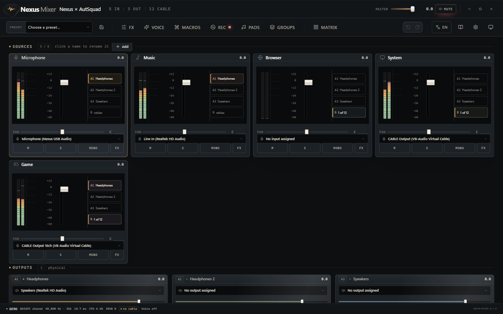
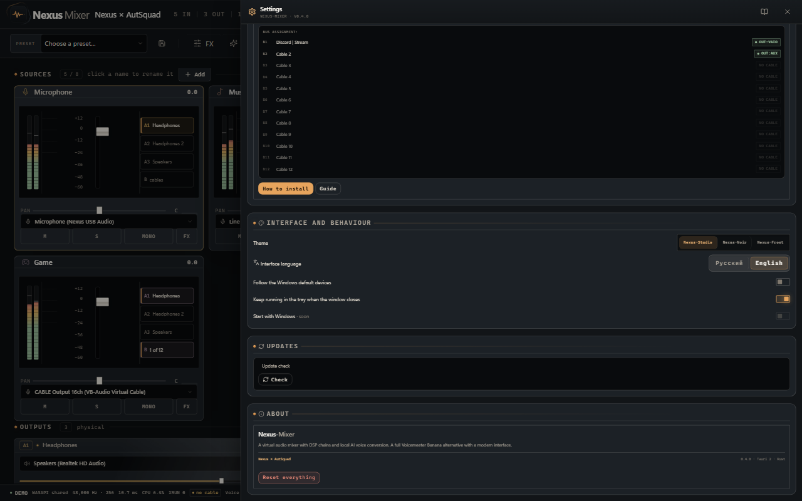
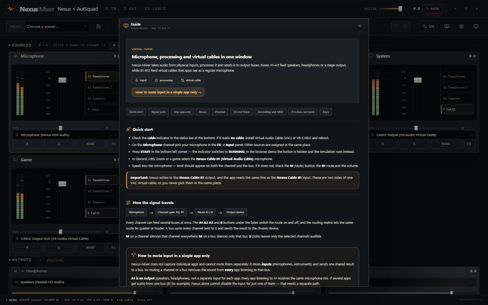
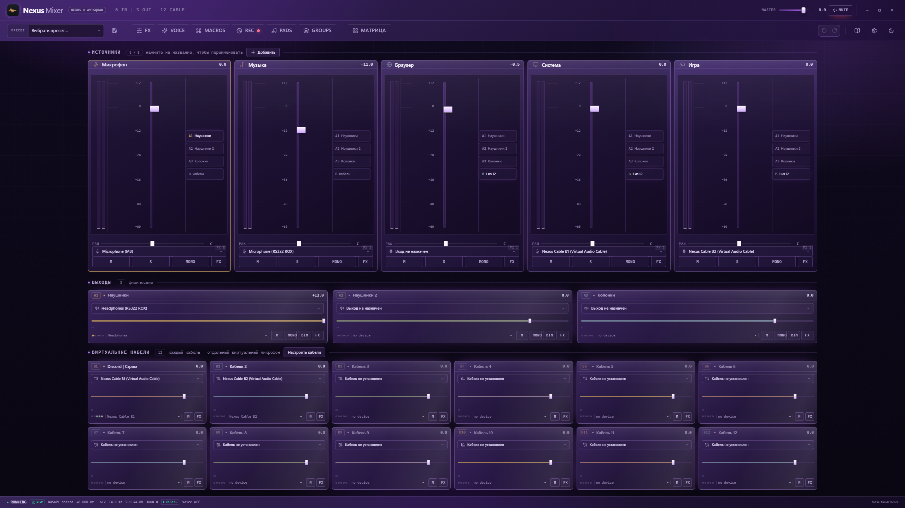
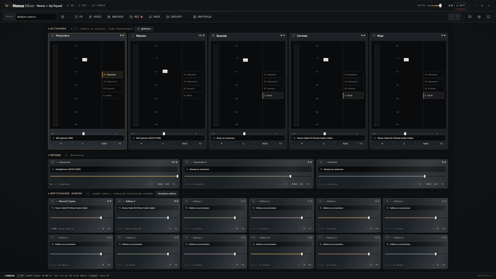
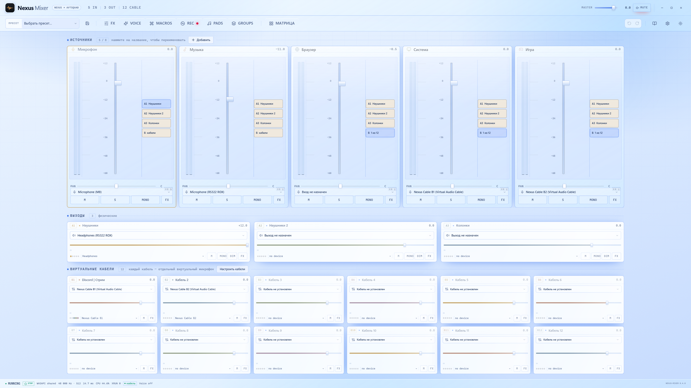

# Nexus-Mixer

**A studio audio console for Windows: 8 sources, 15 buses and 12 virtual cables.**
Microphone, music, browser, games and Discord in one console with DSP, routing and
real-time voice effects.

[Русская версия](README.md)

[](https://github.com/roma1231jjj-cpu/Nexus-mixer/releases/latest)
[](#tests)
[](#installation)
[](https://tauri.app)
[](https://www.rust-lang.org)

> **Nexus × AutSquad** · v0.4.0 · Windows 10/11 x64 · Russian and English UI

| Console | Settings | Guide |
| --- | --- | --- |
|  |  |  |

An instrument panel, not a website: channels, meters, routing and buses are visible
at once, with no tabs and no extra clicks.

---

## Interface language

The whole interface is bilingual — Russian and English. Switching is instant: no
window reload, no engine restart.

- **RU / EN** button in the toolbar, on the right next to the guide.
- **Settings → Interface and behaviour → Interface language** — the same two-state
  switch inside the settings drawer.
- The choice is stored in `localStorage` under the key `nm-lang` and survives an
  app restart. Russian is the default.
- Channel, bus and preset names follow the language; names you typed yourself are
  left untouched.
- Store descriptions, READMEs and release pages are bilingual too.

Deliberately not translated: technology names (Voicemeeter, ASIO, VBAN, WASAPI,
VAC, dB, Hz), file paths and Windows device names.

---

## Three characters

One console, three skins. Switch in the toolbar or in
**Settings → Interface and behaviour**.

| **Nexus-Noir** — default | **Nexus-Studio** — current | **Nexus-Frost** |
| --- | --- | --- |
| Black glass · violet | Matte instrument panel | White glass · blue |
|  |  |  |

A theme is not just a colour swap: text contrast, borders, glow, faders, meters,
device selectors and modal surfaces are rebuilt for each skin.

---

## What is new in 0.4.0

- **Bilingual UI** — Russian and English, switchable in the toolbar and in settings,
  without a reload.
- **Nexus-Noir** — the default black-and-violet glass theme with glow borders.
- **Nexus-Studio** — the familiar matte theme kept as a separate skin.
- **Nexus-Frost** — white-and-blue glass for a bright workspace.
- **Three delivery formats** — installer, single portable `.exe`, portable `.zip`.
- **Nexus × AutSquad signature** in the title bar.
- The portable `.exe` runs without a `resources` folder — the cable script is embedded.
- Old settings migrate to **Nexus-Studio**, so an update does not change the look
  of the console on its own.

Full list — in [CHANGELOG.md](CHANGELOG.md).

---

## What it is

Nexus-Mixer sits between your microphone, your apps and your output devices. We
collect the audio in one mixer, process every channel, spread it across physical and
virtual buses — and hand it to Discord, OBS, Zoom and games as a regular microphone.

- **8 inputs** — 6 hardware + 2 virtual.
- **3 physical outputs** — headphones, a second pair, speakers.
- **12 independent virtual cables** — VAC 4.70, lines `Nexus Cable B1…B12`.
- **8 × 15 matrix** with send level.
- **Realtime Rust/WASAPI engine**, not Web Audio.
- **Local voice presets** — work immediately, no Python and no model downloads.

---

## Features

### Mixer

| | |
| --- | --- |
| Sources | `hw1…hw6`, `vaio`, `aux` — 8 slots, 5 visible by default |
| Outputs | `A1` headphones, `A2` headphones 2, `A3` speakers, `B1…B12` cables |
| Channel | gain, pan, phase, mono, mute, solo, 48V, tilt |
| Bus | EQ, limiter, delay 0–500 ms, stereo width 0–200 %, dim |
| Routing | click to toggle, drag for the send level, keyboard accessible |
| VCA | groups with one fader and mute, assignable to channels |

### Processing

**Channel:** gate → compressor → 10-band EQ → de-esser → saturator → voice tilt.

- hum notches and a high-pass for budget condenser microphones;
- the "velvet" chain: warm low end, boxiness control, a soft top;
- a fully closing gate — fans and background noise never reach Discord;
- 10-band parametric EQ with an interactive curve;
- split-band de-esser, saturator and tilt.

**Bus:** 10-band EQ, lookahead limiter, delay, width, gain/dim/mute.

### Real-time voice

The local DSP engine runs without internet, Python or ONNX models:

- **Monster** — deep and heavy;
- **Demon** — as low as it gets;
- **Giant** — big and calm;
- **Child** — high and childlike;
- **Female** — a soft female timbre;
- **Alien** — thin and strange;
- **Robot** — ring modulation;
- **Whisper** — airy;
- **No effect** — the natural voice.

Plus the **PITCH / FORMANT / MIX** knobs, a source picker and the
**OFF / DSP / AI / HYBRID** modes. Real RVC models still go through the local Python
sidecar — it is optional for the built-in voices.

### Auto-update

- Update check on launch.
- A signed NSIS package downloads in the background.
- An **"Install and restart"** button.
- Manual check: **Settings → Updates**.
- Manifest: [`latest.json`](https://github.com/roma1231jjj-cpu/Nexus-mixer/releases/latest/download/latest.json).

Updates are signed with a Tauri Updater key. The public key lives in
`src-tauri/tauri.conf.json`, the private one only in GitHub Actions Secrets.

### More

- Tray icon, close to tray, "Show window / Quit" menu.
- WAV recorder, 16/24/32-bit, with bus selection.
- Macros and hotkeys.
- MIDI Learn over Web MIDI.
- Undo/Redo for FX.
- State persistence, custom frameless title bar.
- Deep links: `?tab=ai`, `?strip=hw1`, `?bus=B1`, `?theme=studio|dark|light`,
  `?drawer=settings`, `?lang=ru|en`.

---

## Download

All builds live on [GitHub Releases](https://github.com/roma1231jjj-cpu/Nexus-mixer/releases/latest)
and are grouped by version.

| Format | File | Purpose |
| --- | --- | --- |
| Installer | `Nexus-Mixer_0.4.0_x64-setup.exe` | regular install, auto-update |
| Single portable | `Nexus-Mixer_0.4.0_x64-portable.exe` | run without installing |
| Portable archive | `Nexus-Mixer-0.4.0-portable.zip` | portable `.exe` + README |

Inside the project the artifacts go to `release/vX.Y.Z/` and never mix with working
files. The layout is described in [release/README.md](release/README.md).

### Installation

1. Open the [latest release](https://github.com/roma1231jjj-cpu/Nexus-mixer/releases/latest).
2. Download the installer or the portable build.
3. Launch **Nexus-Mixer**.
4. For virtual cables install **Virtual Audio Cable 4.70** (12 lines). Without it the
   physical outputs work, but the virtual buses stay unavailable.

The installer puts the app into `%LOCALAPPDATA%` (or a folder of your choice) and
supports auto-update. The portable build is updated manually.

---

## Building from source

You need **Node.js 22+**, **Rust 1.77+**, **MSVC Build Tools**, the **Windows SDK**
and WebView2.

```powershell
npm ci
npm run dev            # UI in the browser
npm run desktop:dev    # Tauri dev window
npm run desktop:build  # release NSIS
```

Checks before a commit:

```powershell
npm run typecheck
npm run build
```

A full release build with updater artifacts:

```powershell
$env:TAURI_SIGNING_PRIVATE_KEY = "C:\path\to\nexus-updater.key"
$env:TAURI_SIGNING_PRIVATE_KEY_PASSWORD = ""
npx tauri build --no-bundle    # raw exe for the portable build
npx tauri build --bundles nsis # NSIS + .sig + latest.json
```

Or in one command:

```powershell
$env:GITHUB_TOKEN = "..."
$env:TAURI_SIGNING_PRIVATE_KEY = "C:\path\to\nexus-updater.key"
powershell -ExecutionPolicy Bypass -File scripts/release.ps1
```

The script builds all three formats, puts them into `release/vX.Y.Z/`, computes
SHA-256, creates the GitHub Release and uploads `latest.json` for auto-update.

### Tests

```powershell
cd src-tauri
cargo test --all-targets
```

54 engine tests: DSP, routing, VCA, meters, limiter, recorder, the local voice
pitch shifter.

---

## Versions

| Version | Highlights |
| --- | --- |
| **0.4.0** | bilingual UI, Nexus-Studio / Nexus-Noir / Nexus-Frost, 3 delivery formats |
| 0.3.1 | verified end-to-end auto-update |
| 0.3.0 | local voices, updater, GitHub Releases |
| 0.2.1 | 12 VAC cables, velvet chain, stable engine start |

---

## CI / Release

| Workflow | What it does |
| --- | --- |
| [`ci.yml`](docs/workflows/ci.yml) | typecheck + Vite build + Rust tests |
| [`release.yml`](docs/workflows/release.yml) | NSIS, signing, GitHub Release, `latest.json` |

> GitHub refuses to upload `.github/workflows/*` with a token that lacks the
> `workflow` scope. The files live in [`docs/workflows`](docs/workflows) and are ready
> to be moved to `.github/workflows` once the token has that scope.

A release is created by a tag:

```powershell
git tag v0.4.0
git push origin v0.4.0
```

Repository secrets:

| Secret | Value |
| --- | --- |
| `TAURI_SIGNING_PRIVATE_KEY` | the contents of `nexus-updater.key` |

`GITHUB_TOKEN` is provided by Actions automatically.

---

## Architecture

```
src/
  App.tsx                 shell, deep links, auto-update check
  i18n/                   ru.ts + en.ts, per-section dictionaries, useT()/t()
  components/             Strip, Bus, RoutingMatrix, UpdateBanner, SettingsDrawer
  components/rack/        FX, Voice AI, Macros, Recorder, VCA Groups
  store/useMixer.ts       zustand + persist + theme migration
  store/useUpdater.ts     Tauri updater state machine
  lib/engineBridge.ts     typed invoke bridge
  lib/useEngineBridge.ts  sync, meters, device hot-plug
  styles/                 studio.css + console-v2.css + glass.css + lang.css

src-tauri/
  src/engine/             realtime graph, WASAPI runtime, DSP, recorder
  src/engine/dsp.rs       Biquad, gate, compressor, de-esser, pitch shifter
  src/engine/graph.rs     strip → routing → bus, local voice stage
  src/lib.rs              Tauri commands, tray, updater plugins
  tauri.conf.json         window, bundle, updater endpoint

docs/screenshots/         RU and EN interface shots
release/vX.Y.Z/           installer + portable exe + zip + latest.json
docs/workflows/           CI and signed release recipes
tools/ai-sidecar/         optional Python RVC sidecar
docs/                     architecture, AI, driver, roadmap
```

### Signal path

```
WASAPI input → strip gain/pan → gate → compressor → EQ
             → de-esser → saturator → local voice
             → routing matrix → bus EQ/limiter/gain → WASAPI output
```

Everything happens in the audio callback without allocations, locks or panics.
Parameters arrive as a `Copy` snapshot between blocks.

---

## Documentation

- [Architecture](docs/ARCHITECTURE.md)
- [AI / Voice](docs/AI.md)
- [AI sidecar protocol](docs/AI_SIDECAR.md)
- [Virtual driver](docs/DRIVER.md)
- [Roadmap](docs/ROADMAP.md)
- [Changelog](CHANGELOG.md)
- [Release workflow](docs/workflows/release.yml)
- [License](LICENSE)
- [Security](SECURITY.md)

---

## Limitations

- Windows only; WASAPI shared is the main mode.
- Virtual cables require VAC 4.70; the VAC licence is separate.
- Built-in voices are DSP effects, not a neural voice clone. RVC models are connected
  through the sidecar.
- The recorder writes WAV; FLAC/MP3 are on the roadmap.
- The portable build does not install auto-update — update it manually.

---

## License

**Proprietary.** © 2026 Nexus × AutSquad. All rights reserved.

The source code is published for transparency and collaboration. Commercial use,
repackaging and redistribution under another name require written permission from
the authors.
