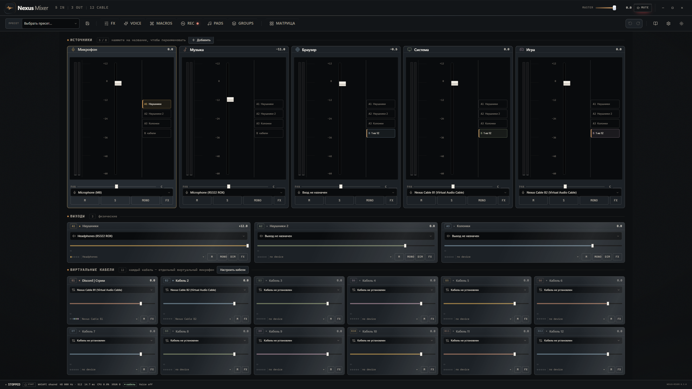
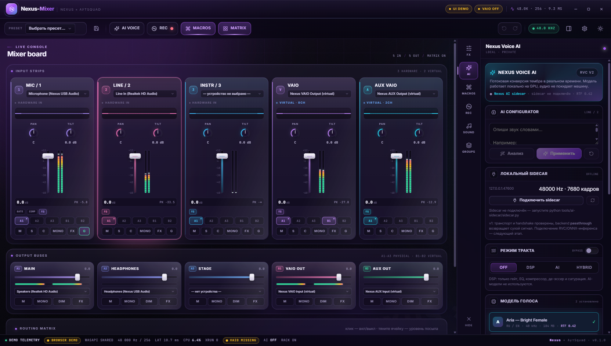
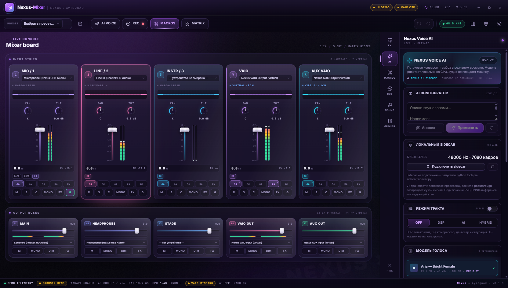
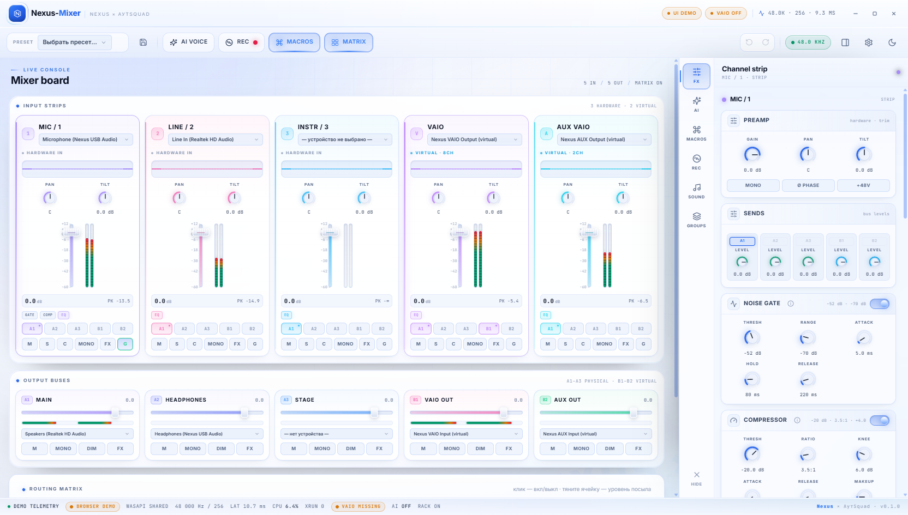

# Nexus-Mixer

**Студийная аудиоконсоль для Windows: 8 источников, 15 шин и 12 виртуальных кабелей.**
Микрофон, музыка, браузер, игры и Discord — в одном матовом микшере с DSP-цепочками,
маршрутизацией и голосовыми эффектами в реальном времени.

[](https://github.com/roma1231jjj-cpu/Nexus-mixer/releases/latest)
[](#тесты)
[](#установка)
[](https://tauri.app)
[](https://www.rust-lang.org)

> **Nexus × АутSquad** · v0.3.1 · Windows 10/11 x64



---

## Что это

Nexus-Mixer встаёт между микрофоном, приложениями и устройствами вывода. Он собирает
весь звук в один микшер, обрабатывает каждый канал, раздаёт его по физическим и
виртуальным шинам — и отдаёт Discord, OBS, Zoom и играм как обычный микрофон.

- **8 входов** — 6 аппаратных + 2 виртуальных.
- **3 физических выхода** — наушники, вторая пара, колонки.
- **12 независимых виртуальных кабелей** — VAC 4.70, линии `Nexus Cable B1…B12`.
- **Матрица 8 × 15** с уровнем посыла.
- **Настоящий realtime-движок** на Rust/WASAPI, а не Web Audio.
- **Локальные голосовые пресеты** — работают сразу, без Python и скачивания моделей.

---

## Возможности

### Микшер

| | |
| --- | --- |
| Источники | `hw1…hw6`, `vaio`, `aux` — 8 слотов, 5 видны по умолчанию |
| Выходы | `A1` наушники, `A2` наушники 2, `A3` колонки, `B1…B12` виртуальные кабели |
| Канал | gain, pan, phase, mono, mute, solo, 48V, tilt |
| Шина | EQ, limiter, delay 0–500 мс, stereo width 0–200 %, dim |
| Маршрутизация | клик — вкл/выкл, drag — уровень, клавиатура — доступно |
| VCA | группы с общим фейдером и mute, назначаются на каналы |

### Обработка

**Канал:** gate → compressor → 10-band EQ → de-esser → saturator → voice tilt.

- hum notches и high-pass для бюджетных конденсаторных микрофонов;
- «бархатная» цепочка: тёплый низ, контроль коробки, мягкий верх;
- gate с полным закрытием — кулеры и фон не проходят в Discord;
- 10-полосный параметрический EQ с интерактивной кривой;
- split-band de-esser, сатуратор и tilt.

**Шина:** 10-band EQ, lookahead limiter, delay, width, gain/dim/mute.

### Голос в реальном времени

Локальный DSP-движок работает без интернета, Python и ONNX-моделей:

- **Монстр** — глубокий, тяжёлый;
- **Демон** — максимально низкий;
- **Великан** — большой и спокойный;
- **Ребёнок** — высокий детский;
- **Женский** — мягкий женский тембр;
- **Пришелец** — тонкий и странный;
- **Робот** — кольцевая модуляция;
- **Шёпот** — воздушный;
- **Без эффекта** — обычный голос.

Плюс ручки **PITCH / FORMANT / MIX**, выбор источника и режимы **OFF / DSP / AI / HYBRID**.
Для настоящих RVC-моделей остаётся локальный Python-sidecar — он не обязателен для
встроенных голосов.

### Автообновление

- Проверка обновлений при запуске.
- Подписанный NSIS-пакет скачивается в фоне.
- Кнопка **«Установить и перезапустить»**.
- Ручная проверка: **Настройки → Обновления**.
- Манифест: [`latest.json`](https://github.com/roma1231jjj-cpu/Nexus-mixer/releases/latest/download/latest.json).

Обновления подписаны ключом Tauri Updater. Публичный ключ лежит в
`src-tauri/tauri.conf.json`, приватный — только в GitHub Actions Secrets.

### Ещё

- Трей, закрытие в трей, меню «Показать окно / Выход».
- Рекордер WAV 16/24/32-bit с выбором шин.
- Макросы и горячие клавиши.
- MIDI Learn через Web MIDI.
- Undo/Redo для FX.
- Тёмная и светлая темы, сохранение состояния.
- Кастомный frameless titlebar.
- Deep links: `?tab=ai`, `?strip=hw1`, `?bus=B1`, `?theme=light`, `?drawer=settings`.

---

## Скриншоты

| Консоль | Голосовые пресеты |
| --- | --- |
|  |  |

| Матрица | Светлая тема |
| --- | --- |
|  |  |

---

## Установка

### Готовый установщик

1. Откройте [последний релиз](https://github.com/roma1231jjj-cpu/Nexus-mixer/releases/latest).
2. Скачайте `Nexus-Mixer_0.3.1_x64-setup.exe`.
3. Запустите установщик. Установка в `%LOCALAPPDATA%` или выбранную папку.
4. Запустите **Nexus-Mixer** из меню «Пуск».

Для виртуальных кабелей нужен **Virtual Audio Cable 4.70** (12 линий). Без него
физические выходы работают, но виртуальные шины будут недоступны.

### Портативная версия

Скачайте `Nexus-Mixer-0.3.1-portable.zip`, распакуйте и запустите `nexus-mixer.exe`.
Портативная сборка не устанавливает автообновление — обновляйте вручную.

---

## Сборка из исходников

Нужны **Node.js 22+**, **Rust 1.77+**, **MSVC Build Tools**, **Windows SDK** и WebView2.

```powershell
npm ci
npm run dev            # UI в браузере
npm run desktop:dev    # Tauri dev-окно
npm run desktop:build  # release NSIS
```

Полная release-сборка с updater-артефактами:

```powershell
$env:TAURI_SIGNING_PRIVATE_KEY = "C:\path\to\nexus-updater.key"
$env:TAURI_SIGNING_PRIVATE_KEY_PASSWORD = ""
npx tauri build --no-bundle   # exe для установки/портативной версии
npx tauri build --bundles nsis # NSIS + .sig + latest.json
```

> Для обычной локальной сборки без автообновления можно временно выставить
> `"createUpdaterArtifacts": false` в `src-tauri/tauri.conf.json`.

### Тесты

```powershell
cd src-tauri
cargo test --all-targets
```

54 теста движка: DSP, маршрутизация, VCA, метры, лимитер, рекордер, локальный
голосовой pitch-shifter.

---

## CI / Release

| Workflow | Что делает |
| --- | --- |
| [`ci.yml`](docs/workflows/ci.yml) | typecheck + Vite build + Rust tests |
| [`release.yml`](docs/workflows/release.yml) | NSIS, подпись, GitHub Release, `latest.json` |

> GitHub ограничивает загрузку `.github/workflows/*` токеном без scope `workflow`.
> Файлы лежат в [`docs/workflows`](docs/workflows) и готовы к переносу в
> `.github/workflows` после выдачи токену этого scope.

Релиз создаётся тегом:

```powershell
# локальный подписанный релиз (без GitHub Actions)
powershell -ExecutionPolicy Bypass -File scripts/release.ps1
```

Или после добавления workflow в `.github/workflows`:

```powershell
git tag v0.3.1
git push origin v0.3.1
```

Нужные секреты репозитория:

| Secret | Значение |
| --- | --- |
| `TAURI_SIGNING_PRIVATE_KEY` | содержимое `nexus-updater.key` |

`GITHUB_TOKEN` выдаётся Actions автоматически.

---

## Архитектура

```
src/
  App.tsx                 каркас, deep links, auto-update check
  components/             Strip, Bus, RoutingMatrix, UpdateBanner, SettingsDrawer
  components/rack/        FX, Voice AI, Macros, Recorder, VCA Groups
  store/useMixer.ts       zustand + persist
  store/useUpdater.ts     Tauri updater state machine
  lib/engineBridge.ts     typed invoke bridge
  lib/useEngineBridge.ts  sync, meters, device hot-plug
  styles/                 studio.css + console-v2.css

src-tauri/
  src/engine/             realtime graph, WASAPI runtime, DSP, recorder
  src/engine/dsp.rs       Biquad, gate, compressor, de-esser, pitch shifter
  src/engine/graph.rs     strip → routing → bus, local voice stage
  src/lib.rs              Tauri commands, tray, updater plugins
  tauri.conf.json         window, bundle, updater endpoint

.github/workflows/        CI and signed release
tools/ai-sidecar/         optional Python RVC sidecar
docs/                     architecture, AI, driver, roadmap
```

### Сигнальный путь

```
WASAPI input → strip gain/pan → gate → compressor → EQ
             → de-esser → saturator → local voice
             → routing matrix → bus EQ/limiter/gain → WASAPI output
```

Всё в audio callback без аллокаций, локов и паник. Параметры приходят
`Copy`-снимком между блоками.

---

## Документация

- [Архитектура](docs/ARCHITECTURE.md)
- [AI / Voice](docs/AI.md)
- [AI sidecar protocol](docs/AI_SIDECAR.md)
- [Виртуальный драйвер](docs/DRIVER.md)
- [Roadmap](docs/ROADMAP.md)
- [Changelog](CHANGELOG.md)
- [Release workflow](docs/workflows/release.yml)
- [Лицензия](LICENSE)
- [Безопасность](SECURITY.md)

---

## Ограничения

- Windows-only; WASAPI shared — основной режим.
- Виртуальные кабели требуют установленного VAC 4.70; лицензия VAC отдельная.
- Встроенные голоса — DSP-эффекты, а не нейросетевой клон голоса. RVC-модели
  подключаются через sidecar.
- Рекордер пишет WAV; FLAC/MP3 — в roadmap.
- Портативная сборка не содержит автообновление.

---

## Лицензия

**Proprietary.** © 2026 Nexus × АутSquad. Все права защищены.

Исходный код публикуется для прозрачности и совместной разработки. Коммерческое
использование, перепаковка и распространение под другим именем — по письменному
разрешению авторов.
