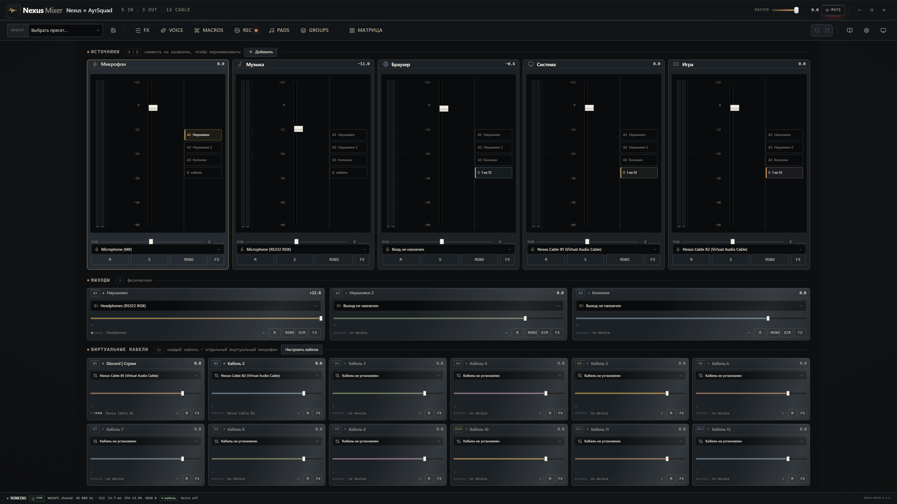

# Nexus-Mixer

**Студийная аудиоконсоль для Windows: 8 источников, 15 шин и 12 виртуальных кабелей.**
Микрофон, музыка, браузер, игры и Discord — в одной консоли с DSP, маршрутизацией
и голосовыми эффектами в реальном времени.

[English version](README.en.md)

[](https://github.com/roma1231jjj-cpu/Nexus-mixer/releases/latest)
[](#тесты)
[](#установка)
[](https://tauri.app)
[](https://www.rust-lang.org)

> **Nexus × АутSquad** · v0.4.0 · Windows 10/11 x64 · интерфейс на русском и английском

| Консоль | Настройки | Инструкция |
| --- | --- | --- |
|  |  |  |

Приборная панель, а не сайт: каналы, метры, маршрутизация и шины видны сразу,
без вкладок и лишних кликов.

---

## Язык интерфейса

Интерфейс полностью двуязычный — русский и английский. Переключение мгновенное,
без перезагрузки окна и без перезапуска движка.

- Кнопка **RU / EN** в тулбаре — справа, рядом с инструкцией.
- **Настройки → Интерфейс и поведение → Язык интерфейса** — там же переключатель
  на два положения.
- Выбор записывается в `localStorage` под ключом `nm-lang` и переживает
  перезапуск приложения. По умолчанию — русский.
- Названия каналов, шин и пресетов переключаются вместе с языком; собственные
  имена, которые вы ввели руками, остаются как есть.
- Тексты лотов, README и страницы релизов — тоже на двух языках.

Что не переводится намеренно: названия технологий (Voicemeeter, ASIO, VBAN,
WASAPI, VAC, dB, Hz), пути к файлам и имена устройств Windows.

---

## Три характера

Одна консоль, три оптики. Переключение — в тулбаре или в
**Настройки → Интерфейс и поведение**.

| **Nexus-Noir** — основная | **Nexus-Studio** — текущая | **Nexus-Frost** |
| --- | --- | --- |
| Чёрное стекло · фиолет | Матовая приборная панель | Белое стекло · синий |
|  |  |  |

Тема — это не смена цвета: пересобраны контраст текста, границы, свечение,
фейдеры, метры, селекторы устройств и модальные окна.

---

## Что нового в 0.4.0

- **Двуязычный интерфейс** — русский и английский, переключатель в тулбаре и в
  настройках, без перезагрузки.
- **Nexus-Noir** — основная чёрно-фиолетовая стеклянная тема с glow-границами.
- **Nexus-Studio** — привычная матовая тема сохранена как отдельный скин.
- **Nexus-Frost** — бело-синее стекло для светлого рабочего места.
- **Три формата поставки** — установщик, одиночный portable `.exe`, portable `.zip`.
- **Подпись Nexus × АутSquad** в титлбаре.
- Портативный `.exe` работает без папки `resources` — скрипт кабелей встроен.
- Старые сохранения мигрируют в **Nexus-Studio**, чтобы обновление не меняло
  привычный вид консоли само по себе.

Полный список — в [CHANGELOG.md](CHANGELOG.md).

---

## Что это

Nexus-Mixer встаёт между микрофоном, приложениями и устройствами вывода. Мы
собираем звук в один микшер, обрабатываем каждый канал, раздаём его по физическим
и виртуальным шинам — и отдаём Discord, OBS, Zoom и играм как обычный микрофон.

- **8 входов** — 6 аппаратных + 2 виртуальных.
- **3 физических выхода** — наушники, вторая пара, колонки.
- **12 независимых виртуальных кабелей** — VAC 4.70, линии `Nexus Cable B1…B12`.
- **Матрица 8 × 15** с уровнем посыла.
- **Realtime-движок Rust/WASAPI**, а не Web Audio.
- **Локальные голосовые пресеты** — работают сразу, без Python и скачивания моделей.

---

## Возможности

### Микшер

| | |
| --- | --- |
| Источники | `hw1…hw6`, `vaio`, `aux` — 8 слотов, 5 видны по умолчанию |
| Выходы | `A1` наушники, `A2` наушники 2, `A3` колонки, `B1…B12` кабели |
| Канал | gain, pan, phase, mono, mute, solo, 48V, tilt |
| Шина | EQ, limiter, delay 0–500 мс, stereo width 0–200 %, dim |
| Маршрутизация | клик — вкл/выкл, drag — уровень, клавиатура — доступно |
| VCA | группы с общим фейдером и mute, назначаются на каналы |

### Обработка

**Канал:** gate → compressor → 10-band EQ → de-esser → saturator → voice tilt.

- hum notches и high-pass для бюджетных конденсаторных микрофонов;
- «бархатная» цепочка: тёплый низ, контроль коробки, мягкий верх;
- gate с полным закрытием — кулеры и фон не проходят в Discord;
- 10-полосный параметрический EQ с интерактивной кривой;
- split-band de-esser, сатуратор и tilt.

**Шина:** 10-band EQ, lookahead limiter, delay, width, gain/dim/mute.

### Голос в реальном времени

Локальный DSP-движок работает без интернета, Python и ONNX-моделей:

- **Монстр** — глубокий, тяжёлый;
- **Демон** — максимально низкий;
- **Великан** — большой и спокойный;
- **Ребёнок** — высокий детский;
- **Женский** — мягкий женский тембр;
- **Пришелец** — тонкий и странный;
- **Робот** — кольцевая модуляция;
- **Шёпот** — воздушный;
- **Без эффекта** — обычный голос.

Плюс ручки **PITCH / FORMANT / MIX**, выбор источника и режимы **OFF / DSP / AI / HYBRID**.
Для настоящих RVC-моделей остаётся локальный Python-sidecar — он не обязателен для
встроенных голосов.

### Автообновление

- Проверка обновлений при запуске.
- Подписанный NSIS-пакет скачивается в фоне.
- Кнопка **«Установить и перезапустить»**.
- Ручная проверка: **Настройки → Обновления**.
- Манифест: [`latest.json`](https://github.com/roma1231jjj-cpu/Nexus-mixer/releases/latest/download/latest.json).

Обновления подписаны ключом Tauri Updater. Публичный ключ лежит в
`src-tauri/tauri.conf.json`, приватный — только в GitHub Actions Secrets.

### Ещё

- Трей, закрытие в трей, меню «Показать окно / Выход».
- Рекордер WAV 16/24/32-bit с выбором шин.
- Макросы и горячие клавиши.
- MIDI Learn через Web MIDI.
- Undo/Redo для FX.
- Сохранение состояния, кастомный frameless titlebar.
- Deep links: `?tab=ai`, `?strip=hw1`, `?bus=B1`, `?theme=studio|dark|light`,
  `?drawer=settings`, `?lang=ru|en`.

---

## Скачать

Все сборки лежат на [GitHub Releases](https://github.com/roma1231jjj-cpu/Nexus-mixer/releases/latest)
и разделены по версиям.

| Формат | Файл | Для чего |
| --- | --- | --- |
| Установщик | `Nexus-Mixer_0.4.0_x64-setup.exe` | обычная установка, автообновление |
| Одиночный portable | `Nexus-Mixer_0.4.0_x64-portable.exe` | запуск без установки |
| Portable-архив | `Nexus-Mixer-0.4.0-portable.zip` | portable `.exe` + README |

Внутри проекта артефакты складываются в `release/vX.Y.Z/` и не смешиваются с
рабочими файлами. Структура описана в [release/README.md](release/README.md).

### Установка

1. Откройте [последний релиз](https://github.com/roma1231jjj-cpu/Nexus-mixer/releases/latest).
2. Скачайте установщик или portable-сборку.
3. Запустите **Nexus-Mixer**.
4. Для виртуальных кабелей установите **Virtual Audio Cable 4.70** (12 линий).
   Без него физические выходы работают, но виртуальные шины будут недоступны.

Установщик ставит приложение в `%LOCALAPPDATA%` (или выбранную папку) и
поддерживает автообновление. Portable-сборка обновляется вручную.

---

## Сборка из исходников

Нужны **Node.js 22+**, **Rust 1.77+**, **MSVC Build Tools**, **Windows SDK** и WebView2.

```powershell
npm ci
npm run dev            # UI в браузере
npm run desktop:dev    # Tauri dev-окно
npm run desktop:build  # release NSIS
```

Проверки перед коммитом:

```powershell
npm run typecheck
npm run build
```

Полная release-сборка с updater-артефактами:

```powershell
$env:TAURI_SIGNING_PRIVATE_KEY = "C:\path\to\nexus-updater.key"
$env:TAURI_SIGNING_PRIVATE_KEY_PASSWORD = ""
npx tauri build --no-bundle    # raw exe для portable
npx tauri build --bundles nsis # NSIS + .sig + latest.json
```

Или одной командой:

```powershell
$env:GITHUB_TOKEN = "..."
$env:TAURI_SIGNING_PRIVATE_KEY = "C:\path\to\nexus-updater.key"
powershell -ExecutionPolicy Bypass -File scripts/release.ps1
```

Скрипт собирает три формата, кладёт их в `release/vX.Y.Z/`, считает SHA-256,
создаёт GitHub Release и загружает `latest.json` для автообновления.

### Тесты

```powershell
cd src-tauri
cargo test --all-targets
```

54 теста движка: DSP, маршрутизация, VCA, метры, лимитер, рекордер, локальный
голосовой pitch-shifter.

---

## Версии

| Версия | Что важно |
| --- | --- |
| **0.4.0** | двуязычный интерфейс, Nexus-Studio / Nexus-Noir / Nexus-Frost, 3 формата поставки |
| 0.3.1 | проверенное сквозное автообновление |
| 0.3.0 | локальные голоса, updater, GitHub Releases |
| 0.2.1 | 12 кабелей VAC, бархатная цепочка, стабильный старт движка |

---

## CI / Release

| Workflow | Что делает |
| --- | --- |
| [`ci.yml`](docs/workflows/ci.yml) | typecheck + Vite build + Rust tests |
| [`release.yml`](docs/workflows/release.yml) | NSIS, подпись, GitHub Release, `latest.json` |

> GitHub ограничивает загрузку `.github/workflows/*` токеном без scope `workflow`.
> Файлы лежат в [`docs/workflows`](docs/workflows) и готовы к переносу в
> `.github/workflows` после выдачи токену этого scope.

Релиз создаётся тегом:

```powershell
git tag v0.4.0
git push origin v0.4.0
```

Секреты репозитория:

| Secret | Значение |
| --- | --- |
| `TAURI_SIGNING_PRIVATE_KEY` | содержимое `nexus-updater.key` |

`GITHUB_TOKEN` выдаётся Actions автоматически.

---

## Архитектура

```
src/
  App.tsx                 каркас, deep links, auto-update check
  i18n/                   ru.ts + en.ts, словари по разделам, useT()/t()
  components/             Strip, Bus, RoutingMatrix, UpdateBanner, SettingsDrawer
  components/rack/        FX, Voice AI, Macros, Recorder, VCA Groups
  store/useMixer.ts       zustand + persist + theme migration
  store/useUpdater.ts     Tauri updater state machine
  lib/engineBridge.ts     typed invoke bridge
  lib/useEngineBridge.ts  sync, meters, device hot-plug
  styles/                 studio.css + console-v2.css + glass.css + lang.css

src-tauri/
  src/engine/             realtime graph, WASAPI runtime, DSP, recorder
  src/engine/dsp.rs       Biquad, gate, compressor, de-esser, pitch shifter
  src/engine/graph.rs     strip → routing → bus, local voice stage
  src/lib.rs              Tauri commands, tray, updater plugins
  tauri.conf.json         window, bundle, updater endpoint

docs/screenshots/         снимки интерфейса RU и EN
release/vX.Y.Z/           installer + portable exe + zip + latest.json
docs/workflows/           CI and signed release recipes
tools/ai-sidecar/         optional Python RVC sidecar
docs/                     architecture, AI, driver, roadmap
```

### Сигнальный путь

```
WASAPI input → strip gain/pan → gate → compressor → EQ
             → de-esser → saturator → local voice
             → routing matrix → bus EQ/limiter/gain → WASAPI output
```

Всё в audio callback без аллокаций, локов и паник. Параметры приходят
`Copy`-снимком между блоками.

---

## Документация

- [Архитектура](docs/ARCHITECTURE.md)
- [AI / Voice](docs/AI.md)
- [AI sidecar protocol](docs/AI_SIDECAR.md)
- [Виртуальный драйвер](docs/DRIVER.md)
- [Roadmap](docs/ROADMAP.md)
- [Changelog](CHANGELOG.md)
- [Release workflow](docs/workflows/release.yml)
- [Лицензия](LICENSE)
- [Безопасность](SECURITY.md)

---

## Ограничения

- Windows-only; WASAPI shared — основной режим.
- Виртуальные кабели требуют установленного VAC 4.70; лицензия VAC отдельная.
- Встроенные голоса — DSP-эффекты, а не нейросетевой клон голоса. RVC-модели
  подключаются через sidecar.
- Рекордер пишет WAV; FLAC/MP3 — в roadmap.
- Portable-сборка не устанавливает автообновление — обновляйте вручную.

---

## Лицензия

**Proprietary.** © 2026 Nexus × АутSquad. Все права защищены.

Исходный код публикуется для прозрачности и совместной разработки. Коммерческое
использование, перепаковка и распространение под другим именем — по письменному
разрешению авторов.
